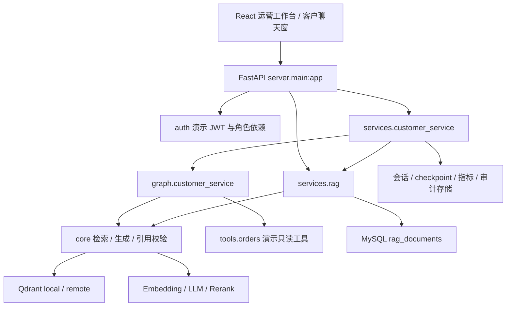

# 智能客服系统架构

> 校准日期：2026-10-14。本文描述当前代码实现；后续设计见 [规划](customer-service-plan.md)，本次检查证据见 [校准记录](documentation-audit.md)。

## 分层与入口



代码统一在 `server/src/server`：`api` 负责 HTTP 契约，`services` 融合业务和存储，`graph` 编排节点，`core` 实现 RAG，`tools` 封装业务源，`auth` 管理演示账号。包通过正规导入复用，没有旧版 `sys.path` 注入与独立 `rag/`、`langgraph/` 仓库。

`server.main:app` 是模块级 FastAPI 实例，挂载 `/api/v1` 路由与根路径 `/metrics`、`/api-info`。`web/dist` 存在时挂载静态前端；`/docs`、`/redoc` 和 `/openapi.json` 是 FastAPI 自动文档。

## 入库与检索

1. 上传 API 校验扩展名并取 basename，落盘到 `SERVER_ROOT/data/uploads`；同名文件覆盖，不提供文档版本。
2. 服务层在 `rag_lock` 内逐文件处理。文本/Markdown 直读；其它格式尝试 MinerU、markitdown、文本降级，云解析使用内容 SHA-256 缓存。
3. 结构切块按标题路径和完整段落聚合，目标 800、overlap 默认 0，长段落可超过目标长度。
4. 本地 FastEmbed 或 OpenAI 兼容远程 embeddings 生成 1024 维向量，Qdrant upsert 并清除同文档过期序号。
5. 配置 MySQL 时尝试保存文档切块、原文件字节和 SHA-256；失败不会回滚已写入向量库。

CLI `ingest` 调核心，不经过 MySQL 备份。`services.rag.ingest_dir` 或上传 API 才具有文档备份步骤。

查询时向量与标题加权 BM25 双路候选按 `(doc, seq)` 去重并 RRF 融合，`score += 1/(60 + rank)`；候选倍数默认 4，返回 top 5。精排有 key 才调用，默认 top 3 与最低阈值 0.3，失败回退融合结果。生成 Prompt 编号素材并要求 `[来源N]`，生成后校验序号范围。

引用范围通过不能证明结论正确，没有引用也可能通过。同步客服图有非法引用重写分支；直接 `/ask` 和流式 RAG 返回校验标志，不保证相同重写行为。

## 客服路由与人工状态

同步消息优先客服图，流式消息在服务层区分显性业务与知识请求：业务/订单续轮走图，知识问答走 RAG 流式。知识无素材首先追问，连续无进展后转人工。订单缺单号追问，查无此单第一次澄清、连续两次转人工；越权/超时/异常进入人工分支。

| 会话状态 | 含义 |
| --- | --- |
| `open` | AI 会话可继续 |
| `waiting` | 等待补充信息 |
| `handoff` | 等待人工处理 |
| `manual` | 坐席已回复 |

人工状态客户新消息只入队并把状态更新为 `handoff`，不继续调用 AI。转人工回复持久化后尝试自动指派坐席；坐席人工回复从登录身份取名称，成功后进入 `manual`。`release` 仅清除坐席归属，不把会话切回 AI。

SSE 使用 `progress/meta/materials/token/done/error`；业务正文通过 `meta` 一次发送，知识正文通过 `token` 增量发送。图分支 `done` 可能只含 `storage`，完整协议见 [API](api.md)。

## 会话、图状态与数据

| 存储 | 当前用途 | 建表/恢复边界 |
| --- | --- | --- |
| `conversations` | 用户/租户占位、状态、人工原因、坐席归属 | 自动建表并补坐席三列 |
| `messages` | 用户/助手内容、来源与回复模式 | 当前代码执行读写，没有自动建表逻辑 |
| `graph_checkpoints` | 服务层知识澄清轮次状态 | 当前代码执行读写，没有自动建表逻辑 |
| `langgraph_checkpoints` / `langgraph_checkpoint_writes` | 客服图原生 checkpoint | checkpointer 首用自动建表 |
| `rag_documents` | 文档切块与可选原文件 | 当前代码没有自动建表/补原文件列逻辑 |
| `evaluation_events` / `evaluation_alerts` | 评测事件与告警存储 | 对应组件自动建表 |
| `rate_limit_counters` / `circuit_breaker_state` / `audit_logs` | 限流、熔断、审计 | 对应组件自动建表 |

数据库名存在两套读取口径：会话/文档/checkpoint 用 `MYSQL_DB`，指标/告警用 `MYSQL_DATABASE`，其余组件兼容两者。部署时两者设为同一库。各组件回退独立发生，会话响应 `storage=mysql` 不代表文档、指标或 checkpoint 一定成功。

`messages`、`graph_checkpoints`、`rag_documents` 的现有字段与读写 SQL 分别以 `services/chat_store.py`、`services/doc_store.py` 为准。没有集中迁移脚本，不能宣称全新 MySQL 自动准备完毕。

会话存储无 MySQL 时为 `memory`，失败后为 `memory_fallback`，本进程不反复重连；回退不迁移 MySQL 历史，内存会随重启丢失。LangGraph 的 `thread_id=conversation_id`，checkpoint 的历史与槽位可跨轮保存；默认生成适配器不把历史传入核心 Prompt，因此不能称为完整多轮 LLM 记忆。

启动 lifespan 只有在 Qdrant 文档集合为空时才尝试从 MySQL 文档切块重建索引。已有部分索引不会自动补全缺失文档；恢复失败写日志而不阻止启动。原始文件虽可保存，当前恢复使用切块重新向量化，不重新解析原文件。

Qdrant payload 包含 `doc/seq/text/para_range/chapter/title/section/heading_path`。ID 计算为：

```python
digest = hashlib.sha256(f"{doc_name}:{seq}".encode("utf-8")).digest()
point_id = int.from_bytes(digest[:8], "big") & ((1 << 63) - 1)
```

默认 embedding 维度固定 1024，换模型须验证维度并重建匹配集合。

## 鉴权与安全范围

JWT 演示账号提供 `operator` / `customer`。会话列表、坐席、人工回复、领取/释放、指标摘要和近期告警要求运营角色；`/auth/me` 要求登录。客户消息可匿名，带有效 token 时身份取 token，客户端 `user_id` 被忽略。知识库端点、`/ask`、会话摘要/消息读取和 `/metrics` 当前没有认证依赖。

`tenant_id` 只是预留字段，未实现知识库/会话多租户访问隔离；订单工具的本人校验不能代替所有资源鉴权。详见 [API 权限表](api.md)。

规则分类器支持多意图优先级、提示注入模式和输入归一化；这些只覆盖当前基线。PII 脱敏接入生成 Prompt、评测/审计 payload 与 API JSON 响应；JSON 中间件跳过 SSE 和非 JSON，不能宣称所有流式 token 都已脱敏。

限流仅覆盖客户消息 POST 和 stream，默认每 IP 30 次/60 秒，超限返回 429 + `Retry-After`；IP 读取 `X-Forwarded-For` 首项或连接来源。订单熔断只把 timeout/error 计为失败，不把 forbidden/not_found 计入。

## 坐席与并发边界

坐席字段 `assignee_id/assignee_name/assigned_at` 已实现 MySQL 与内存双存储；领取通过 CAS 写入，释放仅允许本人。自动指派在最近最多 1000 条会话中按已分配数量选最少者，平局依账号顺序，不检查在线状态、技能组或会话是否结束。

人工回复先检查归属；未分配时尝试 CAS，但当前实现未检查 CAS 返回 False 后的竞争结果，不能宣称并发抢占与回复已经完全闭环。列表先取最近 500 条再过滤，坐席计数与指派先取最多 1000 条，存在截断。详见 [坐席文档](agent-assignment-plan.md)。

Qdrant local 单目录只能由一个进程占用，服务层锁只保护本进程。运行单 worker；远端 Qdrant 解决向量库并发，不自动解决内存回退、指标单例或其它分配竞争问题。

## 指标、告警与日志

JSON `/api/v1/metrics/summary` 支持内存和 MySQL 聚合，含请求量、路由计数、工具状态与时延 P50/P95。一次解决是单条评测事件“无追问/未转人工/无错误”的代理指标，不是用户确认解决率；“无依据承诺”实际以 `citation_valid=false` 近似。

Prometheus `/metrics` 和应用内 `AlertEvaluator` 只消费 recorder 的内存 `events`；MySQL recorder 没有该属性，当前不会读取数据库事件聚合。应用告警默认对全部内存事件累计计算，达到最小 10 样本且比率 >= 阈值触发，没有按时间滑动、去重或冷却。

Prometheus 路由每次抓取调用 `set_recorder` 重置事件游标，可能重复累加已见事件；因此不能据此宣称重复抓取计数幂等。Grafana/Prometheus 配置只是监控配置文件，实际趋势需修正聚合并部署验证。

请求 middleware 设置 `X-Request-ID`，业务日志带当前 trace_id，默认 INFO 可用 `LOG_LEVEL` 覆盖；无请求上下文时为 `-`。本次测试覆盖组件契约，未验证生产 SQL、外部模型或真实网络业务。

## 部署与待办

Docker 多阶段构建前端，Python 3.12 运行后端、同域静态页面、默认端口 80，远程 embedding 代替 FastEmbed。健康端点读库统计与配置，不检查 LLM、MySQL 或业务工具是否就绪；当前没有 `/ready`。

优先补齐：全资源鉴权/租户隔离、数据库迁移、监控 SQL 聚合与抓取幂等、人工回复 CAS 校验、坐席负载分页与在线状态、真实业务源和生产认证。版本路线见 [规划](customer-service-plan.md)。
